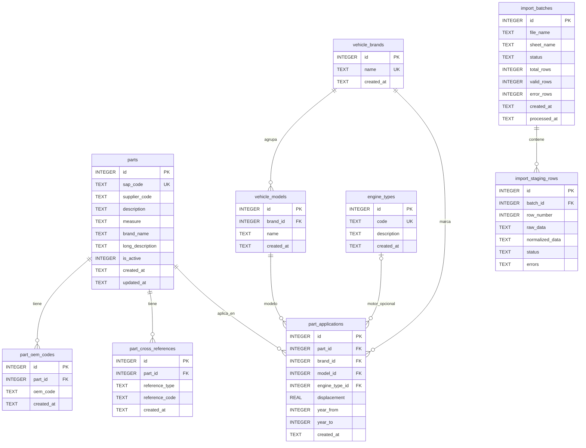

# Diagrama entidad–relación de `catalogo.sqlite3`

Fuente: esquema real de `data/catalogo.sqlite3`, contrastado con `schema.sql`.
`PK` = clave primaria; `FK` = clave foránea. Un círculo en la relación indica participación opcional.

## Puntos para analizar

- `part_applications` enlaza un repuesto con marca, modelo y, opcionalmente, tipo de motor. `displacement` y los años acotan la aplicación.
- `brand_name` en `parts` es texto libre y no tiene clave foránea a `vehicle_brands`.
- Las claves foráneas de `part_applications.brand_id` y `model_id` son independientes: el esquema permite asociar una marca con un modelo de otra marca. Esto requiere validación adicional si se desea impedirlo.
- La restricción `UNIQUE` de SQLite en `part_applications` permite filas repetidas cuando alguna columna de la combinación es `NULL`. La migración de Supabase usa `coalesce(...)` para cubrir ese caso.
- `import_batches` e `import_staging_rows` forman un circuito separado de preparación de archivos. La migración PostgreSQL/Supabase actual contiene las siete tablas del catálogo, pero no estas dos tablas de importación.

## Estado de los datos locales

Al revisar la base local el 23 de octubre de 2026: `parts` 2 filas; `part_oem_codes` 1; `import_batches` 5; `import_staging_rows` 7. Las otras cinco tablas estaban vacías. Estos conteos cambian al usar la aplicación.
