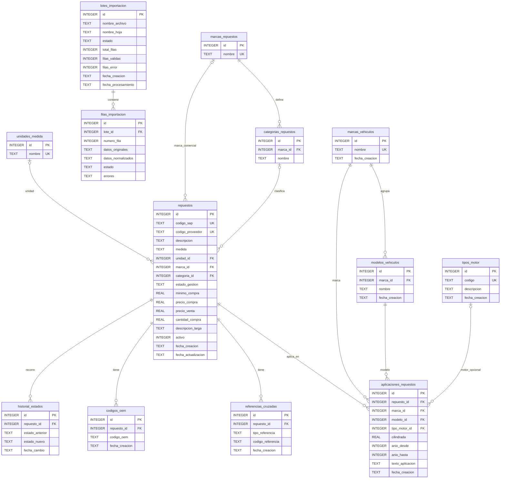

# Diagrama entidad–relación de `catalogo.sqlite3`

Fuente: esquema de `data/catalogo.sqlite3`, definido por `schema.sql` y `schema_gestion.sql`.
`PK` = clave primaria; `FK` = clave foránea. Un círculo en la relación indica participación opcional.

## Puntos para analizar

- `aplicaciones_repuestos` enlaza un repuesto con marca, modelo y, opcionalmente, tipo de motor. `cilindrada` y los años acotan la aplicación.
- `repuestos.marca_id` referencia la marca comercial en `marcas_repuestos`. Cada categoría pertenece a una marca comercial; se valida que coincida con la del repuesto. Las marcas de vehículos se mantienen en `marcas_vehiculos`.
- Las claves foráneas de `aplicaciones_repuestos.marca_id` y `modelo_id` son independientes: el esquema permite asociar una marca con un modelo de otra marca. Esto requiere validación adicional si se desea impedirlo.
- El índice único de `aplicaciones_repuestos` usa `coalesce(...)` y normaliza `texto_aplicacion` para evitar duplicados incluso cuando hay campos vacíos.
- `lotes_importacion` e `filas_importacion` forman un circuito separado de preparación de archivos. La migración PostgreSQL/Supabase actual contiene las siete tablas del catálogo, pero no estas dos tablas de importación.

## Nombres y compatibilidad

Las nueve tablas originales se tradujeron al español el 24 de octubre de 2026. La ampliación comercial agrega cuatro tablas y `vista_repuestos`, que muestra unidad, marca y categoría por nombre. Consulte [DICCIONARIO_DATOS.md](DICCIONARIO_DATOS.md) y [GESTION_COMERCIAL.md](GESTION_COMERCIAL.md) para los campos, etapas y reglas de importación.
