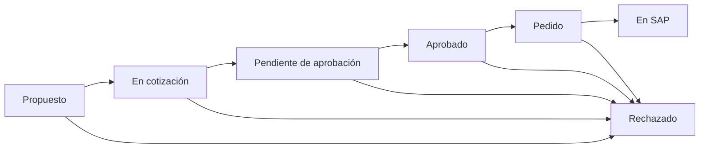

# Clasificación y gestión comercial

Cada repuesto puede tener una unidad de medida, una marca comercial y una categoría de esa marca. Las marcas comerciales se administran en `marcas_repuestos`; las marcas de vehículos siguen en `marcas_vehiculos`. Una marca comercial puede tener muchas categorías y cada repuesto tiene como máximo una.

Los precios de compra y venta son unitarios y se registran en **dólares estadounidenses (USD)**. Las cantidades usan la unidad del repuesto y admiten decimales para metros u otras unidades fraccionables.

## Flujo de trabajo

Los cambios se realizan en orden. Rechazado y En SAP son estados finales. Para pasar a En SAP se requiere `codigo_sap`; desde ese momento quedan cerrados los cambios de estado, mínimo de compra, precios y cantidad de compra. La información técnica y su clasificación siguen disponibles en el catálogo.

Cada repuesto nuevo inicia en Propuesto. Si se registra un artículo que ya existe en SAP, puede iniciarse en En SAP con su código. En una importación nueva con código SAP y estado vacío se usa En SAP. Un estado vacío en un repuesto existente conserva su estado actual.

`historial_estados` registra el estado inicial y cada cambio con su fecha. Repetir un mismo estado no duplica el historial. Los estados se registran manualmente por el operador; esta fase no incluye usuarios aprobadores, permisos por rol ni envío de solicitudes al proveedor.

## Campos para el maestro

En la pestaña Importar se puede descargar una plantilla de dos encabezados con los campos nuevos y los datos técnicos anteriores. Los archivos anteriores siguen siendo compatibles.

| Encabezado | Uso |
| --- | --- |
| `repuestos.codigo_proveedor` | Identifica el repuesto en todas las cargas. |
| `unidades_medida.nombre` | Pieza, Juego, Metro u otra unidad administrada por el usuario. |
| `marcas_repuestos.nombre` | Marca comercial del repuesto. También se acepta `repuestos.nombre_marca` y los alias anteriores. |
| `categorias_repuestos.nombre` | Categoría dentro de la marca comercial. Requiere una marca nueva o ya asignada al repuesto. |
| `repuestos.estado_gestion` | Propuesto, En cotización, Pendiente de aprobación, Aprobado, Pedido, En SAP o Rechazado. |
| `repuestos.minimo_compra` | Cantidad mínima, mayor que cero cuando se informa. |
| `repuestos.precio_compra` | Precio unitario en USD, mayor o igual a cero. |
| `repuestos.precio_venta` | Precio unitario en USD, mayor o igual a cero. |
| `repuestos.cantidad_compra` | Cantidad prevista, mayor o igual a cero. |

En el CSV se aceptan punto o coma decimal, sin separadores de miles. Las celdas vacías conservan el valor existente; cero es un valor informado. Las listas de unidades, marcas y categorías se reutilizan por nombre, ignorando mayúsculas y espacios externos. Las categorías se reutilizan dentro de su marca. Al cambiar la marca del repuesto, se retira la categoría anterior para que pueda elegirse una de la nueva marca.

Los errores numéricos o estados desconocidos aparecen durante la preparación. Las transiciones incompatibles con el estado actual se comprueban al confirmar; si alguna falla, se revierte toda la confirmación del lote.

## Uso en Streamlit

1. En Clasificación, crear o editar unidades, marcas comerciales y categorías. Un valor en uso no puede eliminarse.
2. Crear el repuesto con sus datos técnicos, clasificación y datos comerciales disponibles.
3. Abrir el repuesto y usar Guardar clasificación y gestión para completar cantidades, precios y avanzar de estado.
4. Consultar Historial de estados y filtrar el catálogo por etapa.
5. Informar el código SAP en los datos del repuesto antes de cerrar el seguimiento en En SAP.

## Migración

La actualización crea `catalogo.pre_gestion_comercial.sqlite3` antes de modificar una base anterior. Las marcas existentes se trasladan a `marcas_repuestos`, manteniendo la relación mediante `repuestos.marca_id`. `vista_repuestos` muestra la marca, unidad y categoría por nombre junto con todos los datos del artículo.

Los registros anteriores con código SAP se inicializan en En SAP; los demás, en Propuesto. Los nuevos importes, cantidades, unidades y categorías quedan vacíos hasta que el operador los complete. La migración conserva los identificadores y los datos técnicos y se ejecuta una sola vez.
